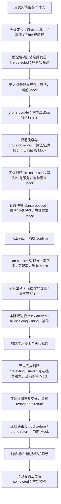

# 火灾应急管理仿真沙盘：前后端与算法交接

> **交接版本：2026-11-18 修订版。** 前端/仿真功能与隔离 Mock 应急流程完成；真实应急算法、真实事件传输和端到端业务联调尚未完成。文中“已实现”表示现有前端能力，不等于真实调度服务已接通。

本文以当前源码为依据，供定位、无人机和应急调度开发者接入现有前端。核心交付是城市二维交通仿真、双无人机展示、八罐三维火场与事件驱动的应急生命周期。定位已通过真实 Offline 算法链路验证；调度、飞行规划、侦察评估和灭火判断由隔离 Mock 提供输入，真实业务服务尚需由同门开发，并通过双方约定的适配层接入。

交接基准日期：2026-11-18。本文件基于现有源码交接内容及最新 Codex 回归报告修订；下文记录的测试通过情况属于项目本地执行报告，不代表本次文档修订时重新运行了测试。

## 1. 系统与启动

React 19 + TypeScript + Vite 提供页面，SVG 展示城市地图，Three.js 展示局部罐区与无人机站。浏览器经 Vite `/api` 代理访问 Python FastAPI Bridge；Bridge 调用 `FireLocalizer`，保存隔离 Session 并提供轮询查询。交通与应急服务运行在浏览器内，共享对象位置和仿真时钟。

二维城市范围为 `CITY90x75`，原始 `LOCAL30x25` 沙盘放置在城市偏移 `(30,25)` 处，原图与原始 POI 不回写。系统有两条独立链路：

- **定位链路**：演示帖子 → 原定位算法 → Session / Prediction → 候选历史、最终 Top1、距离评估。Offline 使用规则提取和字符哈希向量，无付费模型调用。
- **应急链路**：外部业务事件 → `EmergencyService` → 无人机、车辆、交通信号和三维火场。生产入口尚未注册真实 `EmergencyAdapter`，页面初始显示“等待调度连接”。定位完成不会自动生成无人机任务或消防调度。

当前交付目标是冻结已实现的前端仿真与展示能力、明确真实算法接入边界，并准备本地提交。真实算法开发不需要重做地图、渲染、交通执行器和应急面板。

环境要求：Python ≥ 3.11、Node ≥ 22.12。首次安装按根目录 `README.md` 执行 `.venv`、`requirements.txt` 和 `frontend/web/npm ci`。已有便携 Node 位于 `frontend/.tools/node-v24.21.0-win-x64`，`frontend/start-web.ps1` 会自动加入 PATH。

在仓库根目录的两个终端分别运行：

```powershell
./frontend/start-bridge.ps1
./frontend/start-web.ps1
```

浏览器访问 `http://127.0.0.1:5173`，Bridge 默认 `http://127.0.0.1:8080`。`FIRE_PYTHON` 可指定现有解释器。启动不会调用模型；Live 启动须显式确认费用。凭证保存在本机 `.env`，不加入提交。

旧文档 `HANDOFF_README.md` 与 `integration/FRONTEND_API_CONTRACT.md` 保留定位交接背景；其中“415 POI”“消防资源只预留”等描述属于早期阶段。当前合并注册为 **416 项（原始 90 + 扩展 326）**，扩展层级关系新增 `serves`，当前交通、双机及应急行为以本文与源码为准。

## 2. 当前实现与源码入口

| 模块           | 文件路径                                                                                | 真实职责与状态                                                                                                |
| -------------- | --------------------------------------------------------------------------------------- | ------------------------------------------------------------------------------------------------------------- |
| 应用装配       | `frontend/web/src/App.tsx`                                                              | 创建唯一 `TrafficSimulation`、`EmergencyService`，连接交通服务并 `attach()`；订阅应急状态并传给各面板，已实现 |
| 地图           | `frontend/web/src/components/SandboxMap.tsx`                                            | 城市底图、原图叠放、候选/真值/火点、视图与图层控制，已实现                                                    |
| 城市图层       | `frontend/web/src/components/CityLayers.tsx`                                            | 道路/建筑静态图层、POI、订阅交通服务绘制行人，已实现                                                          |
| 沙盘纹理与接缝 | `frontend/web/src/components/SandTableTextures.tsx`                                     | 原图及扩展区域展示纹理；本期接缝优化只改外部视觉连接，不修改原始 PNG                                          |
| POI            | `frontend/web/src/utils/poiRegistry.ts`                                                 | 合并注册表，统一名称与坐标，规范化 Session 和候选，已实现                                                     |
| 坐标           | `frontend/web/src/utils/mapCoordinates.ts`                                              | 局部/城市/二维像素转换，已实现                                                                                |
| 道路拓扑       | `frontend/web/src/utils/roadNetwork.ts`                                                 | 有向车道、转弯连接、车库、`roadPieces`、`getDispatchNetwork()`，已实现                                        |
| 车辆执行       | `frontend/web/src/utils/trafficSimulation.ts`                                           | 车辆运动、碰撞与停车、外部路径校验/执行/遥测、返站，已实现                                                    |
| 信号控制       | `frontend/web/src/utils/trafficSignalController.ts`                                     | 正常周期、占用清空、沿线消防优先、行人放行，已实现                                                            |
| 行人执行       | `frontend/web/src/utils/pedestrianSimulation.ts`                                        | 人行道/斑马线运动与信号等待，已实现                                                                           |
| 车辆图层       | `frontend/web/src/components/VehicleLayer.tsx`                                          | 唯一车辆动画时钟、二维车辆/水流、共享 `sceneActors`，已实现                                                   |
| 信号图层       | `frontend/web/src/components/TrafficSignalLayer.tsx`                                    | 灯具与路口详情，读取同一信号服务，已实现                                                                      |
| 无人机图层     | `frontend/web/src/components/DroneLayer.tsx`                                            | 共用站点、机位、双机与独立路线，已实现                                                                        |
| 应急状态       | `frontend/web/src/utils/emergency.ts`                                                   | `EmergencyService.receive()` 校验事件、状态流转、方案确认、自动恢复/返航请求，已实现                          |
| 应急界面       | `frontend/web/src/components/EmergencyPanel.tsx`                                        | 机队、侦察、等级、方案、确认/取消/重试和错误，已实现                                                          |
| 三维面板       | `frontend/web/src/components/FireScenePanel.tsx`                                        | 根据目标储罐组织场景与火场信息，已实现                                                                        |
| 三维渲染       | `frontend/web/src/components/FireScene3D.tsx`                                           | WebGL、相机、火场/站点视图、逐帧读取共享快照，已实现                                                          |
| 三维模型       | `frontend/web/src/utils/fireScene.ts`                                                   | `buildFireScene()`、火焰/烟雾、车辆/无人机模型及资源释放，已实现                                              |
| 三维数据       | `frontend/web/src/utils/fireSceneData.ts`                                               | 八罐查找、所属罐区几何、坐标转换与站点范围，已实现                                                            |
| TS 契约        | `frontend/web/src/types/index.ts`                                                       | 定位、场景、交通、无人机、事件/命令/适配器类型，已实现                                                        |
| 配置           | `frontend/web/src/config/emergency.json`、`frontend/web/src/config/trafficControl.json` | 双机初值、显示速度、超时、信号时长与过街几何，已实现                                                          |
| 定位 HTTP      | `frontend/web/src/services/api.ts`、`frontend/bridge/server.py`                         | prepare/run/session/reset，真实 Offline 已接通                                                                |
| 定位算法       | `fire_locator/engine.py`、`fire_locator/poi.py`、`fire_locator/providers.py`            | 原算法及参照物读取，已有能力保留；真实业务输入由接入                                                          |
| 联动测试源     | `frontend/web/e2e/emergencyMock.ts`                                                     | 隔离业务数据与测试规划器，不是生产调度服务                                                                    |
| 浏览器验收     | `frontend/web/e2e/acceptance.spec.ts`                                                   | 真实前端完整生命周期及八罐二维/三维映射验证                                                                   |

正式数据：`fire_poi/fire_sandbox_spatial_model.json`、`fire_poi/map_config.json`、`fire_poi/map_original.png`、`city_scene/city_scene.json`、`city_scene/poi_catalog.json`、`city_scene/poi_hierarchy.json`、`city_scene/fire_resources.json`、`city_scene/pedestrian_animation.json`。数据 Schema 为 `city_scene/scene_schema.json`、`city_scene/handoff_schema.json`，指纹清单为 `city_scene/runtime-manifest.json`。

## 3. 空间与对象约定

### 3.1 八个合法火源

应急入口按 `poiRegistry.get(id)?.type === 'Tank'` 检查目标，三维按 `getFireScene(targetId)` 查找原始 Tank。当前恰有下列八个目标；设施、建筑、无人机站不是可选火源。

| 稳定 POI ID | 储罐      | 所属罐区 ID | 原始 LOCAL 中心       | CITY 中心             |
| ----------- | --------- | ----------- | --------------------- | --------------------- |
| `T-NW-01`   | 西北 1 号 | `A-TANK-NW` | (9.626524,15.419447)  | (39.626524,40.419447) |
| `T-NW-02`   | 西北 2 号 | `A-TANK-NW` | (12.393293,15.419447) | (42.393293,40.419447) |
| `T-NE-01`   | 东北 1 号 | `A-TANK-NE` | (17.583841,15.419447) | (47.583841,40.419447) |
| `T-NE-02`   | 东北 2 号 | `A-TANK-NE` | (20.350610,15.419447) | (50.350610,40.419447) |
| `T-SW-01`   | 西南 1 号 | `A-TANK-SW` | (9.717988,8.984747)   | (39.717988,33.984747) |
| `T-SW-02`   | 西南 2 号 | `A-TANK-SW` | (12.393293,9.008580)  | (42.393293,34.008580) |
| `T-SE-01`   | 东南 1 号 | `A-TANK-SE` | (17.446646,8.960915)  | (47.446646,33.960915) |
| `T-SE-02`   | 东南 2 号 | `A-TANK-SE` | (20.167683,8.960915)  | (50.167683,33.960915) |

实际名称以 POI 主数据为准，完整名称有“华安能源”前缀。ID 不重编号。定位结果用 `poi_id`，应急事件用 `targetPoiId`，由接入适配层明确映射。

### 3.2 统一世界坐标

动态对象使用 `CityPosition = Readonly<{ x: number; y: number }>`，范围 X∈[0,90]、Y∈[0,75]，西南原点、东为 +X、北为 +Y。CITY = LOCAL + (30,25)。`Coordinates = {x_m,y_m}` 用于定位结果，不能直接冒充 `CityPosition`。业务数据不得传屏幕像素。

二维渲染由城市坐标映射到 3939×3150 图层，Y 翻转。三维 `cityToScene()` 先减 `(30,25)`，再调用 `localToScene()`：X 乘 `1312/30` 后减 656；Z 为 `524.5 - localY * 1049/25`；Three.js 的 Y 表示高度。比例来自原图像素中心，转换由前端负责，业务端不传换算后的场景坐标。

`heading` 为从东向逆时针的弧度。**当前 `altitude` 是相对地面的原图像素显示高度，不是米**；真实飞行高度须由适配层按双方确认的规则换算。二维、三维均使用同一个 `DRONE-*` / `EXT-FIRE-VEHICLE-*` ID 和同一份位置快照。

### 3.3 消防站、无人机站与资源

`EXT-P-DRONE` 中心为 `(28.6,24)`，平台范围 X=27.4..29.8、Y=22.4..25.6，容量 2。`parent_id` 为 null，通过 `station_poi_id: 'EXT-P-FIRE'` 和层级关系 `serves` 关联消防站，不虚构社区父级；`can_post=false`。

| 资源                  | CITY 停靠位置 | 数据来源                                                            |
| --------------------- | ------------- | ------------------------------------------------------------------- |
| `DRONE-01`            | (28.6,23.15)  | `fire_resources.json.drone_station.bays` 与 `emergency.json.drones` |
| `DRONE-02`            | (28.6,24.85)  | 同上                                                                |
| `EXT-FIRE-VEHICLE-01` | (18.35,16)    | `fire_resources.json.vehicles`、场景车位                            |
| `EXT-FIRE-VEHICLE-02` | (20,16)       | 同上                                                                |
| `EXT-FIRE-VEHICLE-03` | (21.65,16)    | 同上                                                                |

资源文件的历史 `status: reserved` 是静态资源元数据，运行状态由仿真服务维护。消防站通过 `EXT-R-009` 接入道路，入口 `(20,17.6)`，道路连接点 `(20,20)`。

## 4. 已实现行为

### 4.1 双机显示与移动

两架无人机从配置初始化为 `idle`，有独立 `position/heading/altitude/status/path/updatedAt/targetPoiId`。`DroneLayer` 订阅应急服务与交通时钟，绘制双机和两条不同颜色的路线；`EmergencyPanel` 显示任务状态。

`drone.update` 可直接上报位置，也可上报从当前位置开始的折线路径。路径首点距上报位置不得超过 0.05 世界单位，至少两点。前端以配置的 2.4 世界单位/仿真秒沿路径插值；到达末点后清除路径，**不会自动生成侦察完成、评估结果或充电状态**。外部业务必须上报这些结果。返航路径同样由外部输入，落地后发送新版本 `idle` 或 `charging` 快照。

这是显示插值与路径执行，不承担真实航迹规划、避障、续航或协同任务算法。全局暂停/倍速影响仿真移动，三维相机/视觉渲染使用自己的显示时钟。

### 4.2 交通实际策略

`TrafficSimulation` 维护 53 辆普通车辆和 3 辆消防车，行人使用正式 318 节点、440 边网络。`roadNetwork.ts` 组合原始与扩展机动车道路，按过街点细分车道并生成转弯连接；`vehicle_allowed=false` 的道路不进入机动车网络（含 R-08～R-11）。

正常周期按可兼容的车辆方向组、行人组轮转，配置车辆绿灯 10 秒、行人绿灯 8 秒、全红 1.5 秒。占用未清空时等待；相邻短连接区共享清空与阶段约束。车辆/行人实际运动调用 `canEnterVehicle()` / `canEnterPedestrian()`，红灯会阻止进入，已经进入的对象继续清空。

**正式应急方案中 `trafficLockdown=true` 的当前含义是沿线信号优先**：确认成功后设置 `emergency_priority`，按消防车未来 12 世界单位范围请求对应路口方向，先全红并等待占用清空，再给消防方向放行；冲突方向停车，其他路口保持正常周期。消防车仍受路径、占用和碰撞约束。

`TrafficControlMode` 还保留 `emergency_lockdown` 全城入口封锁模式，但当前 `EmergencyService.confirm()` 不选择它。不要依据旧阶段文档把全城停车写成当前调度策略。`trafficLockdown=false` 保持正常模式，已确认消防车获得应急通行授权；此模式下授权消防车可越过灯色，但仍检查路口占用。

`fire.extinguished` 自动停止喷水、撤销出动消防车授权、切回 `normal`，恢复普通周期并请求资源返航。当前没有独立的“交通管制/恢复”网络事件，精确控制恢复时机的新协议需双方另行确认。

外部批准路径的最终停车路段在消防车到场前就触发普通车辆合法绕行，避免普通车夹在两辆消防车之间形成堵塞；绕行沿用已有道路连接，不改写消防车批准路径。

### 4.3 三维场景

`getFireScene()` 根据目标储罐选择所属罐区，构造该区储罐、管线、建筑与相邻道路范围。`buildFireScene()` 创建原图贴地、罐体、火焰着色器、烟雾、光源和动态 actors；支持火场与消防/无人机站视图。

火情状态为 `normal | burning | extinguishing | extinguished`。等级使用 **`FireSceneSeverity = 1 | 2 | 3`**，分别为小/中/大火，影响火焰尺度与烟雾数量；当前接口不接受 `small | medium | large`。业务端若使用文字枚举，由适配层显式映射为数字。

`VehicleLayer` 汇合 `traffic.sceneSnapshot` 和 `emergency.getSceneActors()` 到 `sceneActors.current`，`FireScene3D` 逐帧读取。场景内可见对象按当前局部范围裁剪，飞出局部视图不代表对象丢失。喷水由业务开始灭火事件控制，火焰/烟雾在灭火完成事件后消失，不用固定倒计时推断灭火成功。

## 5. 两条接入契约

### 5.1 已存在的定位 HTTP

以下路径来自 `frontend/bridge/server.py` 与 `services/api.ts`，请求/响应均为 JSON：

| 方法与路径                                  | 输入/输出                                                                         | 标识与异常处理                                                          |
| ------------------------------------------- | --------------------------------------------------------------------------------- | ----------------------------------------------------------------------- |
| `GET /api/health`                           | `Health`：status、algorithm、default_mode、live_requires_confirmation             | 无事件 ID；页面每 10 秒健康检查                                         |
| `GET /api/pois`                             | 原始 90 项 `Poi[]`                                                                | 用稳定 `poi_id`，不是合并注册表                                         |
| `GET /api/scenarios`                        | 八罐 scenarios、default_target_poi_id                                             | 场景目标必须为八罐之一                                                  |
| `GET /api/spatial-data`                     | version、original、extended、extended_relations、city_offset、spatial_fingerprint | 当前扩展 326 项；关系包含 `part_of`、`serves`                           |
| `POST /api/scenarios/prepare`               | target_poi_id、mode、seed → 201 Session                                           | 默认 T-SW-01/offline/42；禁止额外字段，非法输入 422；每次准备新 Session |
| `POST /api/localization/run`                | session_id、confirm_paid_api → 202 Session                                        | 未确认 Live 为 403，重复启动/过期数据指纹为 409；不自动重发             |
| `GET /api/localization/{session_id}`        | Session                                                                           | 32 位十六进制会话 ID；未知为 404；轮询可重复                            |
| `POST /api/localization/{session_id}/reset` | `{}` → 201 新 Session                                                             | 运行中拒绝 409，保留旧会话                                              |

prepare 的 mode 为 `offline | live`，seed 范围 0..2³¹−1。`Session.status` 为 `prepared | running | completed | failed`；有 `created_at/started_at/completed_at` 时间字符串与数据指纹。Session ID 不是应急 incident ID。接口请求没有 `messageId` 或事件版本；prepare/reset 不是幂等重试接口。

定位结果的实际 TS 类型摘录如下（完整 Session 与 Candidate 见 `src/types/index.ts`）：

```ts
type Coordinates = { x_m: number; y_m: number };
type Candidate = Pick<Poi, 'poi_id' | 'name' | 'coordinates'> & {
  rank: number; votes: number; confidence: number; score: number;
  relative_score: number; cluster_ids?: string[];
  region_name?: string; parent_name?: string;
};
type Prediction = {
  coordinate_system?: 'LOCAL30x25' | 'local_cartesian_meters' | 'CITY90x75';
  candidates: Candidate[]; processed_count: number; pending_count: number;
  active_cluster_count: number; cold_cluster_count: number;
  status: string; current_time?: string;
};
```

| 定位字段                                     | 类型/必填性                         | 含义、来源与前端处理                                             |
| -------------------------------------------- | ----------------------------------- | ---------------------------------------------------------------- |
| `coordinate_system`                          | 三种坐标系字符串，选填              | 缺省按旧 LOCAL；服务返回后经 `normalizeSession()` 按注册表规范化 |
| `candidates`                                 | `Candidate[]`，必填，可空           | 算法排序；rank=1 为 Top1，空列表显示无候选                       |
| `poi_id/name/coordinates`                    | string/string/Coordinates，候选必填 | 算法返回；已注册 ID 优先用主数据名称和中心                       |
| `rank/votes/confidence/score/relative_score` | number，候选必填                    | 算法真实结果；颜色由证据强度派生，不当作校准概率                 |
| `cluster_ids`                                | string[]，选填                      | 支持簇；`region_name/parent_name` 是前端派生选填字段             |
| `processed_count/pending_count`              | number，必填                        | 算法处理进度                                                     |
| `active_cluster_count/cold_cluster_count`    | number，必填                        | 算法簇计数                                                       |
| `status/current_time`                        | string 必填/string 选填             | 算法状态与时间；不是应急状态机事件                               |

传给 `normalizeSession()` 前的候选结构示例（分值仅说明字段格式，真实值必须来自算法）：

```json
{
  "coordinate_system": "CITY90x75",
  "candidates": [{
    "poi_id": "T-SW-01", "name": "华安能源西南罐区1号储罐",
    "coordinates": {"x_m": 39.717988, "y_m": 33.984747},
    "rank": 1, "votes": 4, "confidence": 0.7,
    "score": 2.1, "relative_score": 1, "cluster_ids": []
  }],
  "processed_count": 10, "pending_count": 0,
  "active_cluster_count": 1, "cold_cluster_count": 0, "status": "ready"
}
```

真实调用链：`App.run()` → `api.run()` → Bridge SessionService → `FireLocalizer(settings, offline=..., state_path=..., resume=False)` → 每批 10 条 `ingest(posts, flush=True)` → 批次 `prediction` / `batch_history` → 最终 `prediction()` → GET Session 轮询 → `normalizeSession()` → 地图与结果区。当前演示每轮 100 条。

真实帖子类型为 `Post{id,timestamp,text,location_poi_id,urgency}`（模型见 `fire_locator/models.py`）；timestamp 是分钟精度时间，text 为 1..4000 字，urgency 为“低/中/高”。Bridge 演示 run 不接收帖子数组。可选的独立算法服务 `fire_locator/api.py` 有 `POST /posts`、`GET /prediction`、`GET /pois`、`GET /health`，不带 `/api` 前缀，与网页 Bridge 区分。真实帖子入口的部署、鉴权与回传方式由数据提供方落实，并与前端/定位负责人联合确认。

**定位与应急尚未自动桥接**：接入方须根据经确认的定位结果，用稳定 POI ID 建立 `fire.detected` 事件，不能把演示 `ground_truth` 当作真实定位依据。

### 5.2 应急适配器与数据类型

当前可调用接口是进程内契约，没有已发布的调度 HTTP 路径或 WebSocket topic：

```ts
interface EmergencyAdapter {
  readonly source?: string;
  subscribe(receive: (event: unknown) => void): () => void;
  execute(command: EmergencyCommand, signal: AbortSignal): Promise<void>;
  resolveRoute?(
    dispatch: FireTruckDispatch, from: CityPosition, signal: AbortSignal
  ): Promise<FireTruckRoute>;
}
```

前端接入位置为 `connectEmergencyAdapter(adapter)`（`utils/emergency.ts`），返回解除连接函数。它支持先登记适配器、随后 `EmergencyService.attach()` 连接；也可连接已挂载服务。生产 `src` 不导入 `emergencyMock` 或浏览器测试驱动。

`subscribe` 把业务消息交给接收回调，注销函数负责移除监听；`execute` 成功 resolve 表示命令已受理，不代表车辆到达或火已扑灭。失败应 reject，遵守 `AbortSignal`；来源名称会显示在应急面板。接入层需要记录拒绝结果时，可使用服务的 `receive(input)` 返回值 `{accepted,error?}`；适配器回调本身为 void，尚无网络 ACK 协议。

以下为源码数据类型（readonly 不改变 JSON 结构）：

```ts
type CityPosition = Readonly<{ x: number; y: number }>;
type FireSceneSeverity = 1 | 2 | 3;
type DroneStatus = 'idle' | 'dispatched' | 'flying' | 'observing' | 'returning' | 'charging';
type DroneSnapshot = Readonly<{
  id: string; position: CityPosition; heading: number; altitude: number;
  status: DroneStatus; targetPoiId?: string;
  path?: readonly CityPosition[]; updatedAt: number;
}>;
type FireAssessment = { targetPoiId: string; source?: string; assessedAt?: number } & (
  { status: 'completed'; severity: FireSceneSeverity; result: string } |
  { status: 'pending' | 'failed'; message?: string }
);
type FireTruckRoute = Readonly<{ pieceIds: readonly string[]; stop: number }>;
type FireTruckDispatch = Readonly<{
  vehicleId: string; targetPoiId: string; targetPosition: CityPosition;
  route?: FireTruckRoute; path?: readonly CityPosition[];
  status: 'dispatched' | 'en_route' | 'arrived' | 'extinguishing' | 'returning' | 'idle';
}>;
type EmergencyPlan = Readonly<{
  id: string; targetPoiId: string; trafficLockdown: boolean;
  dispatches: readonly FireTruckDispatch[]; summary: string;
}>;
```

| 对象字段                         | 类型                | 必填 | 数据来源、约束与用途                                                   |
| -------------------------------- | ------------------- | ---- | ---------------------------------------------------------------------- |
| Drone `id`                       | string              | 是   | 双机之一；外部系统 ID 在适配层映射                                     |
| Drone `position`                 | CityPosition        | 是   | 业务位置或显示航迹起点，CITY 坐标                                      |
| Drone `heading/altitude`         | number              | 是   | 有限数；altitude≥0，显示高度单位见 3.2                                 |
| Drone `status`                   | DroneStatus         | 是   | 业务执行状态；派遣/飞行状态登记本次任务机队                            |
| Drone `targetPoiId`              | string              | 否   | 八罐之一，存在时必须与 incident 目标一致                               |
| Drone `path`                     | CityPosition[]      | 否   | 至少两点，从 position 开始；idle/charging 时不执行                     |
| Drone `updatedAt`                | number              | 是   | ≥0；每架无人机严格递增，跨 incident 也保留最后值                       |
| Assessment `targetPoiId/status`  | string/状态联合     | 是   | 侦察判断；目标必须一致                                                 |
| Assessment `severity/result`     | 1\\                 | 2\\  | 3 / string                                                             |
| Assessment `message`             | string              | 否   | pending/failed 的解释，提供时非空                                      |
| Assessment `source/assessedAt`   | string/number       | 否   | 来源名称非空、时间为有限数；不充当版本校验                             |
| Plan `id/targetPoiId/summary`    | string              | 是   | 非空方案 ID、当前目标、可读调度说明                                    |
| Plan `trafficLockdown`           | boolean             | 是   | true 为当前沿线信号优先，false 保持正常模式                            |
| Plan `dispatches`                | FireTruckDispatch[] | 是   | 非空、无重复，车辆必须属于三车资源                                     |
| Dispatch `vehicleId/targetPoiId` | string              | 是   | 调度车辆和当前储罐                                                     |
| Dispatch `targetPosition`        | CityPosition        | 是   | 外部规划提供火场位置；适配层须用目标储罐 CITY 中心，入口未自动比较中心 |
| Dispatch `status`                | 状态联合            | 是   | 虽类型列出多状态，`plan.proposed` 入口要求为 `dispatched`              |
| Dispatch `route`                 | FireTruckRoute      | 否   | 确认时必须已有，或由 resolveRoute 补齐                                 |
| Dispatch `path`                  | CityPosition[]      | 否   | 类型保留的折线路径；不会替代可执行 route，不会自动寻路                 |
| Route `pieceIds`                 | string[]            | 是   | 当前 `getDispatchNetwork()` 中连续的有向路段/连接 ID                   |
| Route `stop`                     | number              | 是   | 最后路段上的弧长停止位置，≥0 且不超过该段长度                          |

外部规划读取 `getDispatchNetwork()` 导出的 `{id,points,length,next,road}`；`road` 在车库/连接段上可能缺省。ID 如 `lane:*`、`turn:*`、`garage:*` 属于当前导出网络，拓扑更新后须重新同步，不能假定跨版本永久不变。当前没有网络下载该拓扑的专用 HTTP 端点。

`validateExternalRoute()` 要求第一段等于车辆当前段，后续段沿 `next` 连续；单段停止位置不能倒退，末点距 dispatch.targetPosition 不超过 `ARRIVAL_RADIUS`（以源码常量为准）。`confirm()` 在异步受理前后都校验路径，防止规划期间车辆位置改变。`truck.position` 限制批准路径上的进度，偏离 0.08 世界单位或倒退会被拒绝，不会瞬移绕过信号/碰撞。

### 5.3 应急入站事件

所有事件共享实际信封：

```ts
type EventEnvelope = Readonly<{
  messageId: string; incidentId: string; occurredAt: number;
}>;
```

| 通用字段     | 必填/类型            | 处理约定                                                                 |
| ------------ | -------------------- | ------------------------------------------------------------------------ |
| `messageId`  | 是，非空 string      | 接入方生成唯一值；当前服务实例全局去重，不要跨 incident 复用             |
| `incidentId` | 是，非空 string      | 同一起处置保持一致；生产业务生成，区别于 Session ID                      |
| `occurredAt` | 是，有限 number≥0    | 源端事件时间，供部分类型时序校验；双方统一使用 Unix 毫秒是建议的接入约定 |
| `type`       | 是，下面列出的字面量 | 传输层保持原名，不能自行新造现有事件                                     |
| `version`    | 当前类型没有该字段   | 若未来需要协议版本，在适配层约定并转换；现有入口不按未知字段执行版本协商 |

下表的字段加上通用信封构成每个事件。未标选填的字段均必填。所有来源为业务/适配层；当前隔离测试由 `emergencyMock.ts` 提供。

| 事件 type             | 专有字段与类型                                                                   | 接收后的实际动作与顺序/失败条件                                                                                                |
| --------------------- | -------------------------------------------------------------------------------- | ------------------------------------------------------------------------------------------------------------------------------ |
| `fire.detected`       | `targetPoiId: string`                                                            | 创建 burning/fire_detected；已有未完成 incident 拒绝新 ID；相同 incident 不允许换罐                                            |
| `drone.update`        | `drone: DroneSnapshot`                                                           | 派遣/飞行/位置/路线统一入口；observing 前必须已派遣；确认中/已确认后不能重新派遣侦察                                           |
| `drone.observed`      | `droneId: string`                                                                | 记录侦察完成、状态 observing 并停止本机路线；必须已分配本次任务，时间不早于派遣                                                |
| `fire.assessed`       | `assessment: FireAssessment`                                                     | completed 要求所有已派遣无人机完成侦察；更新等级/结论并清除旧方案；pending/failed 将火场显示设为 normal，failed 另进入失败状态 |
| `plan.proposed`       | `plan: EmergencyPlan`                                                            | 要求侦察全部完成、评估 completed；进入 awaiting_confirmation；已执行方案不能覆盖                                               |
| `truck.route`         | `vehicleId: string; route: FireTruckRoute`                                       | 已确认方案中车辆才可更新；灭火作业中拒绝；灭火后作为返航路径执行                                                               |
| `truck.position`      | `vehicleId: string; position: CityPosition; updatedAt: number`                   | 接受已调度车辆沿批准路径的遥测进度，拒绝越界/离路/倒退                                                                         |
| `truck.arrived`       | `vehicleId: string`                                                              | 车辆须已沿批准路径实际 arrived；更新到场列表，不能提前上报跳过运行                                                             |
| `truck.extinguishing` | `vehicleId: string`                                                              | 车辆须实际 arrived；开启该车喷水，fireStatus=extinguishing                                                                     |
| `fire.extinguished`   | 无专有字段                                                                       | 已确认且已进入 extinguishing 才接受；关闭火/烟/喷水，恢复交通，发送返航命令                                                    |
| `truck.return`        | `vehicleId: string; route?: FireTruckRoute`                                      | 灭火后执行；有 route 时校验执行，无 route 时用已有 sendHome 返站能力                                                           |
| `drone.return`        | `drone: DroneSnapshot`                                                           | 只接受 returning/idle/charging 快照；可带返航 path；仍检查目标、单机 updatedAt 与路径起点                                      |
| `operation.failed`    | `operation: 'drone'\\|'assessment'\\|'dispatch'\\|'extinguish'; message: string` | 显示业务失败并保存重试前阶段；message 必须非空                                                                                 |

源码 `EmergencyEvent` 即信封与以上 payload 联合，例如：

```ts
type EmergencyEvent = Readonly<{
  messageId: string; incidentId: string; occurredAt: number;
}> & (
  { type: 'fire.detected'; targetPoiId: string } |
  { type: 'drone.update'; drone: DroneSnapshot } |
  { type: 'drone.observed'; droneId: string } |
  { type: 'fire.assessed'; assessment: FireAssessment } |
  { type: 'plan.proposed'; plan: EmergencyPlan } |
  { type: 'truck.position'; vehicleId: string; position: CityPosition; updatedAt: number } |
  { type: 'truck.route'; vehicleId: string; route: FireTruckRoute } |
  { type: 'truck.arrived' | 'truck.extinguishing'; vehicleId: string } |
  { type: 'fire.extinguished' } |
  { type: 'truck.return'; vehicleId: string; route?: FireTruckRoute } |
  { type: 'drone.return'; drone: DroneSnapshot } |
  { type: 'operation.failed'; operation: 'drone' | 'assessment' | 'dispatch' | 'extinguish'; message: string }
);
```

**接收与重复处理适用于每个事件**：`receive()` 在唯一入口校验 unknown，格式/顺序/路径失败返回 `accepted:false` 并写入 `inputError`；成功消费才登记 messageId。重复 messageId 与已完成 incident 返回 accepted:true，不再次执行。部分早到/过期消息也以 accepted:true 忽略，因此 accepted 不代表发生状态变化。

非位置事件按 incident+事件类型+车辆/observed 无人机 ID 检查 occurredAt，严格更早的消息忽略；不是全局排序器。无人机位置/返航按同一飞机的 updatedAt，≤最后值即忽略；消防遥测同样按其 updatedAt。重复 observed、同方案 ID、已灭火重复完成、已登记车辆返航另有业务幂等。侦察或方案事件必须不早于本次各机完成时间。

这些消息集合和时间记录保存在内存，页面刷新后不持久化；当前不保证断线重放与全状态恢复。接入方应保持有序发送、唯一 ID 与对象版本，重连恢复策略在正式传输层落地前双方确认。

### 5.4 出站命令与交通动作

```ts
type EmergencyCommand = Readonly<{ commandId: string; incidentId: string }> & (
  { type: 'plan.confirm'; plan: EmergencyPlan } |
  { type: 'responders.return'; vehicleIds: readonly string[]; droneIds: readonly string[] } |
  { type: 'operation.retry'; operation: string }
);
```

| 命令/调用           | 必填字段与来源                                                                        | 受理、失败与重复语义                                                                                                                           |
| ------------------- | ------------------------------------------------------------------------------------- | ---------------------------------------------------------------------------------------------------------------------------------------------- |
| `plan.confirm`      | commandId/incidentId/type、plan；前端确认按钮生成                                     | commandId=`incidentId:planId:confirm`；全部路径准备/校验 → adapter.execute 受理成功 → 再校验 → 交通优先/车辆出动；失败保留待确认，车辆不提前动 |
| `responders.return` | commandId/incidentId/type、vehicleIds:string[]、droneIds:string[]；灭火完成后前端生成 | commandId=`incidentId:return`；每次处置成功请求一次，失败可重试同 ID；业务方再发 truck.return/drone.return 执行结果                            |
| `operation.retry`   | commandId/incidentId/type、operation:string；前端重试按钮                             | commandId=`incidentId:retry:operation`；受理后恢复失败前阶段；reject 保留错误                                                                  |
| `resolveRoute()`    | dispatch、from:CityPosition、AbortSignal；前端缺少 route 时调用                       | 业务方返回 FireTruckRoute；无实现/非法路径时确认失败；不是网络事件                                                                             |
| 交通启动            | 无独立事件 ID；方案的 trafficLockdown                                                 | 方案确认成功后调用 `signals.setMode('emergency_priority')`；接口保留字段名                                                                     |
| 交通恢复            | 无独立事件 ID；消费 fire.extinguished                                                 | 自动 `setMode('normal')`、撤销出动车辆授权；重复灭火完成不重复返航请求                                                                         |

三个命令都没有 occurredAt 或显式 version；业务服务必须按 commandId 幂等受理，避免超时重试重复出动。适配器应在 reject 中提供可读错误。默认请求超时 15000ms，断开适配器会 abort 在途请求。Abort 不保证远端已受理任务撤销，业务端需要用 commandId 查明受理结果。

### 5.5 可复用 JSON 消息示例

以下是可通过实际类型表达&#x7684;**接入格式示例**，不是已经接通的服务端消息。顺序和 ID 保持一致；生产端生成真实时间与 ID。

```json
[
  {"type":"fire.detected","messageId":"I-001:1","incidentId":"I-001","occurredAt":1000,"targetPoiId":"T-SW-01"},
  {"type":"drone.update","messageId":"I-001:2","incidentId":"I-001","occurredAt":1100,
   "drone":{"id":"DRONE-01","position":{"x":28.6,"y":23.15},"heading":0.785398,"altitude":110,"status":"flying","targetPoiId":"T-SW-01","path":[{"x":28.6,"y":23.15},{"x":39.717988,"y":33.984747}],"updatedAt":1100}},
  {"type":"drone.update","messageId":"I-001:3","incidentId":"I-001","occurredAt":1200,
   "drone":{"id":"DRONE-01","position":{"x":39.717988,"y":33.984747},"heading":0.785398,"altitude":110,"status":"observing","targetPoiId":"T-SW-01","updatedAt":1200}},
  {"type":"drone.observed","messageId":"I-001:4","incidentId":"I-001","occurredAt":1300,"droneId":"DRONE-01"},
  {"type":"fire.assessed","messageId":"I-001:5","incidentId":"I-001","occurredAt":1400,
   "assessment":{"targetPoiId":"T-SW-01","status":"completed","severity":2,"result":"储罐顶部可见明火，完成空中侦察","source":"侦察服务","assessedAt":1400}},
  {"type":"plan.proposed","messageId":"I-001:6","incidentId":"I-001","occurredAt":1500,
   "plan":{"id":"PLAN-001","targetPoiId":"T-SW-01","trafficLockdown":true,"summary":"派遣一辆消防车，启动沿线信号优先",
     "dispatches":[{"vehicleId":"EXT-FIRE-VEHICLE-01","targetPoiId":"T-SW-01","targetPosition":{"x":39.717988,"y":33.984747},"status":"dispatched"}]}}
]
```

示例方案有意省略 route，接入者须实现 `resolveRoute` 后才能确认。等级和车辆数由业务方独立决策，前端没有按等级强制车辆数。真实调度路径须来自当前网络；不要把示例车道 ID 串当成可行规划。

车辆沿批准路径实际抵达后、完成判断产生后，继续发送：

```json
[
  {"type":"truck.arrived","messageId":"I-001:7","incidentId":"I-001","occurredAt":2000,"vehicleId":"EXT-FIRE-VEHICLE-01"},
  {"type":"truck.extinguishing","messageId":"I-001:8","incidentId":"I-001","occurredAt":2100,"vehicleId":"EXT-FIRE-VEHICLE-01"},
  {"type":"fire.extinguished","messageId":"I-001:9","incidentId":"I-001","occurredAt":3000}
]
```

前端随后生成的命令形如：

```json
{"type":"responders.return","commandId":"I-001:return","incidentId":"I-001","vehicleIds":["EXT-FIRE-VEHICLE-01"],"droneIds":["DRONE-01"]}
```

业务方受理返航后回传：

```json
[
  {"type":"truck.return","messageId":"I-001:10","incidentId":"I-001","occurredAt":3100,"vehicleId":"EXT-FIRE-VEHICLE-01"},
  {"type":"drone.return","messageId":"I-001:11","incidentId":"I-001","occurredAt":3200,
   "drone":{"id":"DRONE-01","position":{"x":39.717988,"y":33.984747},"heading":-2.356194,"altitude":110,"status":"returning","targetPoiId":"T-SW-01","path":[{"x":39.717988,"y":33.984747},{"x":28.6,"y":23.15}],"updatedAt":3200}},
  {"type":"drone.return","messageId":"I-001:12","incidentId":"I-001","occurredAt":4000,
   "drone":{"id":"DRONE-01","position":{"x":28.6,"y":23.15},"heading":1.570796,"altitude":0,"status":"charging","updatedAt":4000}}
]
```

最后一条应在真实落地完成时产生，不能用示例时间或固定倒计时冒充飞行结果。`checkCompleted()` 等全部本次消防车 idle、返航登记齐全、已派遣无人机 idle/charging 才进入 completed。

## 6. 业务顺序、通信边界与责任



状态主线为 `fire_detected → drone_dispatched → observing → assessment_completed → awaiting_confirmation → traffic_lockdown（沿线优先时） → fire_trucks_dispatched → fire_trucks_en_route/arrived → extinguishing → extinguished → traffic_restored → returning → completed`。部分状态由同步连续 publish 或遥测事件产生，界面不保证逐项停留。事件合法性以第 5 节为准，不能靠强制修改 phase 跳过前置步骤。

确认按钮调用链：`EmergencyPanel` → `EmergencyService.confirm()` → 全部 route/resolveRoute → 校验 → `adapter.execute(plan.confirm)` → 再校验 → `signals.setMode()` / `applyExternalDispatch()`。灭火调用链：`receive(fire.extinguished)` → `apply()` → `setExternalWater(false)` → 撤销授权 → `setMode(normal)` → `requestReturn()` → adapter.execute → 返航事件 → `checkCompleted()`。

目前具备定位 HTTP、Session 轮询与进程内应急数据契约；Bridge 没有应急事件推送端点，也没有 WebSocket 服务器。生产应急协议的承载方式、地址、鉴权、部署、网络重连与消息确认均待双方确定，不应直接在调用方假定存在某个 URL/topic。

**待双方确认的设计建议**：由同门负责提供真实业务服务并明确事件顺序与幂等语义，前端负责维护一个实现现有 `EmergencyAdapter` 的传输模块。选用 HTTP 轮询还是 WebSocket 后，再确定地址和环境配置；接入模块负责解码、文字等级转换、对象 ID 与坐标映射。传输层检测断连时应通知界面并中止在途请求，重连先对齐业务快照与命令受理记录，再决定补发；当前服务没有自动重放恢复实现。

当前 `connected` 表示适配器已登记订阅，不自动检测物理网络健康；断开适配器会 abort 请求，但不会自动停车或重置现场。错误事件进入 failed，已运行的交通/对象保持现状。调度与交通是否在断线后继续运行，由双方在业务策略中明确，不能把现有 connected 当作远端心跳保证。

## 7. 分工、缺口与开发顺序

| 类别       | 当前成果/缺口                                                                                | 责任                                                 |
| ---------- | -------------------------------------------------------------------------------------------- | ---------------------------------------------------- |
| 前端已完成 | 地图/POI、双机站点/轨迹/状态、交通执行与信号、八罐三维火烟/喷水、方案确认/取消/重试/状态同步 | 前端维护现有组件与服务                               |
| 契约已具备 | EmergencyEvent / Command / Adapter、外部车辆路径与遥测入口                                   | 按契约产出数据，前端实现协商后的传输适配器           |
| 真实输入   | 真实告警/帖子、真实定位结果接入与事件关联                                                    | 定位模块；前端配合绑定 Session/incident              |
| 无人机算法 | 任务分配、航迹规划、避障、协同、现场侦察、返航和落地决策                                     | 算法/业务服务                                        |
| 火情判断   | 小中大火判断、结果说明、灭火完成判断                                                         | 业务服务；适配层输出 1/2/3                           |
| 消防调度   | 选车、出动/返航时机、批准路径、到场/作业结果                                                 | 调度服务，前端执行与显示                             |
| 交通策略   | 是否请求沿线优先；当前恢复绑定灭火完成                                                       | 决定业务时机；若需独立恢复命令，双方先更新契约再实现 |
| 联调验收   | 真实事件全生命周期、异常/重放、二维三维一致性                                                | 双方共同验收                                         |

现有能力边界：同一时间处理一个 incident；去重/状态不跨刷新保存；真实应急传输尚未实现；高度为显示单位；路径 ID 随拓扑版本同步；无人机无前端避障；消防遥测仍受显示执行器约束。`drone.return` 的入口未把“灭火后才能返航”作为硬限制，接入方负责业务合法顺序。`truck.extinguishing` 检查车辆实际到场，不强制先消费 truck.arrived；协议仍建议依次报告两种执行结果。

### 7.1 同门交付任务与验收口径

| 任务                   | 同门需要交付的实际产物                                                 | 应复用的现有前端入口                                                                        | 交付验收                                                     |
| ---------------------- | ---------------------------------------------------------------------- | ------------------------------------------------------------------------------------------- | ------------------------------------------------------------ |
| 真实火情输入与事件关联 | 告警/帖子接入、定位结果与 `incidentId` 关联、确认后的合法 Tank 目标    | 定位 HTTP 与 `fire.detected`                                                                | 不使用 Ground Truth 冒充真实预测；定位及事件指向同一合法储罐 |
| 无人机分配与航迹       | `DRONE-01/02` 任务选择、航迹、位置/方向/显示高度换算、返航及落地状态   | `drone.update`、`drone.observed`、`drone.return`                                            | 时序与版本单调；按任务要求完成侦察才允许评估                 |
| 火情等级评估           | 真实侦察判断、`severity` 数值 1/2/3、判断说明和失败事件                | `fire.assessed`、`operation.failed`                                                         | 评估对象与本次 incident 匹配，前置侦察门槛不可跳过           |
| 消防调度与路径         | 选车、方案说明、连续有向道路 `pieceIds`、合法停车弧长 `stop`           | `plan.proposed`、`resolveRoute()`、`plan.confirm`                                           | 无非法路径；确认前不出车；到场、避碰与停靠满足现有执行器约束 |
| 应急交通策略           | 决定方案是否开启沿线优先和解除时机，必要时提出协议扩展需求             | `trafficLockdown`、现有信号控制器                                                           | 验证冲突方向互斥、社会交通停车/恢复；不要误写为全城全红      |
| 灭火与资源回收         | 到场/作业事件、灭火完成业务判断、返航命令与最终落地/归位状态           | `truck.arrived`、`truck.extinguishing`、`fire.extinguished`、`truck.return`、`drone.return` | 不靠动画计时伪造灭火完成；恢复后车辆和无人机回到待命         |
| 真实事件通信           | 运行中的业务服务、事件推送/命令受理、幂等/超时/鉴权/重连约定与联调环境 | `EmergencyAdapter.subscribe/execute/resolveRoute`                                           | 完整真数据链路可复现；刷新/断链语义双方明确                  |

**交接时仍需双方确认的事项：** 火情确认由谁作出、真实帖子数据从哪里来、通信方式与鉴权、真实无人机高度到显示高度的换算、道路拓扑版本、独立交通恢复是否需要扩展事件、断线后的应急安全策略。未经双方确认，不应将建议协议写成已上线接口。

建议开发顺序：

1\. 双方冻结当前 POI、CITY 坐标、等级数字和对象 ID，核对本次 `getDispatchNetwork()` 与道路版本。负责业务模型，前端负责 `src/types`、`utils/emergency.ts` 等契约维护，避免同时直接改同一文件。

2\. 将真实输入接入定位模块并建立定位结果 → incident 的映射，前端继续复用现有 Prediction 显示。

3\. 完成一架无人机的分配/航迹/侦察，再接第二架及协同；验证严格递增 updatedAt、全部侦察完成后才评估。

4\. 完成等级判断、选车与连续 route；前端对接 `resolveRoute/execute` 与确认流程。

5\. 提供到场、灭火判断、返航/落地事件；双方验证沿线优先与恢复。

6\. 双方确定正式传输、连接配置、超时/命令幂等/重连恢复，再接入真实端到端验收。

## 8. 联调验收与本次回归

| 验收项   | 必须观察到的结果                                                                           |
| -------- | ------------------------------------------------------------------------------------------ |
| 真实定位 | 八罐稳定 ID 与中心正确，ground_truth 不参与推理，不用 Mock 预测代替真实定位                |
| 双机任务 | 两个 ID 可独立接收真实任务、更新路径/位置；过期 updatedAt 不回退                           |
| 侦察等级 | 全部本次派遣无人机完成后才接受 completed 评估，显示正确等级与来源                          |
| 调度执行 | 无路径/不连续路径/受理失败不出动；确认成功后选定车辆沿批准路径运行                         |
| 交通协同 | 正常红灯实际停车、行人等待；沿线路口正确优先，其他路口继续运行，无碰撞                     |
| 灭火完成 | 实际到场并开始作业前拒绝提前完成；真实完成事件让火/烟/喷水消失                             |
| 交通恢复 | 完成后模式 normal，无遗留优先；车辆和行人恢复周期                                          |
| 资源返航 | 真实返航命令/结果匹配，消防车归位、双机落地 idle/charging 后才 completed                   |
| 异常幂等 | 重复 messageId 不重复调度，错误 incident/格式/目标/路径不会推进业务；命令按 commandId 去重 |
| 视图一致 | 二维、三维、应急信息区使用相同目标、对象 ID 与坐标源；局部裁剪行为符合预期                 |

正式回归命令（仓库根目录为起点；Node 未在 PATH 时先加入便携目录）：

```powershell
$env:Path = (Join-Path (Get-Location) 'frontend/.tools/node-v24.21.0-win-x64') + ';' + $env:Path
Push-Location frontend/web
npm.cmd run typecheck
npm.cmd run build
npm.cmd test
Pop-Location
$env:PYTHONUTF8 = '1'
$env:PYTHONDONTWRITEBYTECODE = '1'
$env:LANGSMITH_TRACING = 'false'
$env:LANGCHAIN_TRACING_V2 = 'false'
$regressionTemp = Join-Path ([IO.Path]::GetTempPath()) ('fire-final-' + [guid]::NewGuid().ToString('N'))
./.venv/Scripts/python.exe -B -m pytest tests frontend/bridge/tests -p no:cacheprovider --basetemp=$regressionTemp -q
$env:FIRE_ACCEPTANCE_DIR = Join-Path ([IO.Path]::GetTempPath()) ('fire-final-browser-' + [guid]::NewGuid().ToString('N'))
Push-Location frontend/web
npm.cmd run test:e2e -- --reporter=list --output="$env:FIRE_ACCEPTANCE_DIR/playwright-results"
Pop-Location
```

运行浏览器回归前确保 5173/8080 没有其他服务占用，配置会启动自己的隔离服务；不复用用户服务。`FIRE_ACCEPTANCE_DIR` 同时把用例主动截图/JSON 放到系统临时目录，`--reporter=list` 不生成 HTML 报告。无需保留开发期 `artifacts` 才能复验。

**最新版本结果说明：** 表格使用 2026-11-18 最新一次 Codex 收尾回归结果（前端 160/160、Python/Bridge 44/44、E2E 20/20）；本次只是修订交接文档，没有在当前环境重新执行 Windows 仓库中的测试。

历史构建报告中主 JS 包约 1.64 MB（gzip 约 329 kB），存在 Vite 超过 500 kB 的体积提示，不影响构建通过；最新构建具体字节数以本机重新运行结果为准，本阶段不扩大范围拆包。

| 检查            | 本次结果                                                                         |
| --------------- | -------------------------------------------------------------------------------- |
| TypeScript      | PASS                                                                             |
| 生产构建        | PASS                                                                             |
| 前端单元测试    | **160/160 PASS**；据最新 Codex 报告，新增四组确定时钟的消防停车/到场生命周期回归 |
| Python / Bridge | 44/44 PASS                                                                       |
| Playwright      | **20/20 PASS，0 跳过**；以最新完整回归为准                                       |

测试质量边界：单元测试通过 Mock 提供业务输入并验证真实服务状态/交通执行；浏览器用例对 Vite 模块插入只读观察代码，仍运行实际 React/SVG/Three.js/运动逻辑。部分定位展示用例拦截定位响应，真实 Offline 由 dashboard 与 acceptance 用例分别验证。应急业务输入与测试规划来自隔离 Mock，不代表真实算法服务联通。生产入口不包含这些测试钩子。

历史 E2E 曾为 19/20：消防车受阻后提前判定到场，占用了后车已分配停车空间，导致后车无法进入目标路段。最新修复增加停车净空与车辆碰撞约束，使用四组固定仿真时钟的完整生命周期用例对照验证：旧代码稳定复现两组路径失败，修复后四组通过；随后完整 E2E 达到 20/20。此前 52/53 表示恢复窗口内移动中的普通车辆数，而非初始车辆总数（初始为 53）；当时缺少逐车状态，不能断言它与路径失败完全同根因。最新回归报告记录四组与完整 E2E 均验证 53 辆车恢复运动。

## 9. 提交候选与历史工作保护

当前分支 `main`，对照 `origin/main`；本轮只准备清单，不执行暂存、提交、推送、PR 或部署。`baseline-git-status.txt` 与源码指纹确认开发前已有 14 项已跟踪前端修改及多项未跟踪前端文件。它们是本次工程的基础，保留在工作区，不通过 Git 恢复或批量清理覆盖。

本次交接文档编写后又完成地图接缝显示层优化、停车净空修复及相应测试。 地图视觉修复主要涉及 `CityLayers.tsx`、`SandTableTextures.tsx`；消防停车问题涉及 `trafficSimulation.ts` 与新增 `emergencyParking.test.ts`。完整前端提交须包含前三阶段基础实现、无人机站点数据、地图接缝展示修改和最新停车回归，不应只提交最后几次修复。

按照用户最新提供的 `git status --short`，提交候选暂列 **53 个具体文件**（预计 24 个已跟踪修改、29 个新增文件，包含尚未展开的 `src/config/` 中两个配置文件）。此数量需要在本机使用 `git status --short --untracked-files=all` 再次逐文件核实后确定，不应仅凭文件夹汇总输出直接暂存。

```text
FRONTEND_BACKEND_HANDOFF.md
city_scene/city_scene.json
city_scene/fire_resources.json
city_scene/generate.mjs
city_scene/handoff_schema.json
city_scene/poi_catalog.json
city_scene/poi_hierarchy.json
city_scene/runtime-manifest.json
city_scene/scene_schema.json
frontend/README.md
frontend/web/package.json
frontend/web/package-lock.json
frontend/web/playwright.config.ts
frontend/web/e2e/dashboard.spec.ts
frontend/web/e2e/acceptance.spec.ts
frontend/web/e2e/emergency.spec.ts
frontend/web/e2e/emergencyDriver.ts
frontend/web/e2e/emergencyMock.ts
frontend/web/e2e/fireScene.spec.ts
frontend/web/e2e/postFix.spec.ts
frontend/web/e2e/sceneHarness.tsx
frontend/web/e2e/spatialAlignment.spec.ts
frontend/web/e2e/trafficSignals.spec.ts
frontend/web/src/App.tsx
frontend/web/src/index.css
frontend/web/src/types/index.ts
frontend/web/src/components/CityLayers.tsx
frontend/web/src/components/SandTableTextures.tsx
frontend/web/src/components/SandboxMap.tsx
frontend/web/src/components/VehicleLayer.tsx
frontend/web/src/components/DroneLayer.tsx
frontend/web/src/components/EmergencyPanel.tsx
frontend/web/src/components/FireScene3D.tsx
frontend/web/src/components/FireScenePanel.tsx
frontend/web/src/components/TrafficSignalLayer.tsx
frontend/web/src/config/emergency.json
frontend/web/src/config/trafficControl.json
frontend/web/src/utils/roadNetwork.ts
frontend/web/src/utils/trafficSimulation.ts
frontend/web/src/utils/trafficSimulation.test.ts
frontend/web/src/utils/emergency.ts
frontend/web/src/utils/emergency.test.ts
frontend/web/src/utils/emergencyParking.test.ts
frontend/web/src/utils/fireScene.ts
frontend/web/src/utils/fireScene.test.ts
frontend/web/src/utils/fireSceneData.ts
frontend/web/src/utils/fireSceneData.test.ts
frontend/web/src/utils/pedestrianSimulation.ts
frontend/web/src/utils/trafficAudit.test.ts
frontend/web/src/utils/trafficSignalController.ts
frontend/web/src/utils/trafficSignalController.test.ts
frontend/web/src/utils/trafficSignalGeometry.ts
tests/test_localization.py
```

`tests/test_localization.py` 的 POI 总数更新为 416，并增加无人机站资源/几何/Schema 验证，属于站点交付的一部分。原始 `fire_poi`、定位算法、Bridge、原图/道路资源和 `city_scene/assets` 的 29 个基线文件哈希一致，原城市几何和原有 POI 内容未改写；新增站点及对应 Schema/指纹是必要变更。

以下八份报告建议继续留在本地，不混入本次正式功能提交；前七份为早期阶段报告，第八份为本次地图接缝修复报告：

```text
frontend/PHASE1_3D_DELIVERY.md
frontend/PHASE2_TRAFFIC_DELIVERY.md
frontend/PHASE3_FINAL_DELIVERY.md
frontend/PHASE3_FIX_AND_ACCEPTANCE_REPORT.md
frontend/PHASE3_LAYOUT_V2_DELIVERY.md
frontend/PHASE3_LAYOUT_V3_DELIVERY.md
frontend/PHASE3_PRE_ACCEPTANCE_AUDIT.md
frontend/CITY90_MAP_SEAM_REPAIR_REPORT.md
```

不提交 `.env`、`.venv`、`node_modules`、本机工具/缓存、运行目录、构建输出、截图、Playwright 报告/trace 或中间验收文件。旧日期与基线已有截图/报告不纳入本次删除范围，保持既有忽略规则，不新增隐藏规则来掩盖文件。

清理对象为 `artifacts/2026-11-18-traffic-drone-fire/`，含 baseline、before、checkpoint、final、verified、specialist、specialist-recheck、unit、review-runtime 和本次 pytest 缓存/临时目录。清理前逐层统计为 1,795 个文件、612 个子目录、1,274,275,922 字节（约 1.19 GiB）；删除后该目录文件/子目录/占用均为 0（连同运行根目录共删除 613 个目录）。Git 未跟踪文件从完整统计的 1,709 项降至 35 项，期间新增本文 1 项。保留 `artifacts` 父目录、`.venv`、`node_modules` 和基线已有历史产物。检查 `tests`、`fire_locator`、`frontend/bridge` 未发现本次遗留的 Python 缓存，临时诊断测试已移除。

用户最近一次 `git status --short` 输出为 **24 个已跟踪文件修改、36 条未跟踪状态项（其中 `frontend/web/src/config/` 以目录形式折叠显示）、0 个已暂存文件**；`git diff --check` 未见格式错误，LF/CRLF 提示属于工作树换行转换警告。本文按 53 个具体提交候选和 8 份不提交的阶段报告预估；提交前须展开未跟踪目录、检查完整差异和敏感信息，再确认最终数量。Codex 最新回归报告判定 `READY TO COMMIT`，但实际 Git 暂存及本地提交仍需负责人逐文件审核后操作。