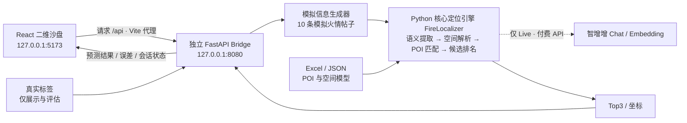
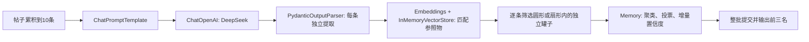

# 城市异常定位智能体系统 · Fire Localization Demo

火灾应急管理仿真沙盘系统基于多源火情信息理解与 POI 空间推理，将 Python / LangChain 核心定位引擎、FastAPI Bridge 与 React 可视化前端集成为完整软件系统，支持火灾定位研究与数字沙盘演示。

系统流程：**火情信息输入 → 语义理解 → 空间定位 → POI 匹配 → 定位结果 → 数字沙盘展示**。

**第一次 Demo：`demo-v1.0` · 主分支：`main` · 当前仓库：Private。**

仓库：[DStevenFelix/fire-localization-demo](https://github.com/DStevenFelix/fire-localization-demo)。私有仓库需要先获得访问权限并完成 GitHub 身份认证，才能克隆。

[Windows 安装](#windows-安装与配置) · [启动演示](#启动演示) · [常见问题](#常见问题) · [核心定位引擎说明](#核心定位引擎说明) · [项目主线文档](FIRE_PROJECT_MASTER_ROADMAP.md)

## 核心功能

- **火情语义定位**：从居民火情信息中提取参照物和方向，结合空间约束推断火点。
- **POI 空间匹配**：匹配登记地点，筛选空间关系范围内的独立储罐。
- **Top3 候选**：展示候选 POI、算法得分，并支持点击候选高亮地图。
- **真实位置与预测位置对比**：Ground Truth 与 AI Prediction 同图叠加，展示距离误差；重合时两种标记均可辨。
- **二维沙盘可视化**：底图、POI、缩放、拖动、图层切换及 Agent 处理流程示意。

## 系统架构



FastAPI Bridge 调用 `PoiRepository`、`demo.generate` 和 `FireLocalizer`，连接 POI 空间模型、模拟信息生成与核心定位引擎，保持定位算法稳定。真实标签不进入推理或候选排名。前端 Agent 流程是现有处理流程的说明，运行状态来自整轮任务，不表示新增了独立 Agent 服务。

Python 后端的实时 API（`fire_locator.api:app`，端口 8000）是另一种集成入口；**启动本网页 Demo 只需 Bridge 和 React 两个进程**。

## 项目目录

```text
fire-localization-demo/
├── fire_locator/                    # Python 后端与核心定位引擎
├── frontend/
│   ├── bridge/                      # 独立 FastAPI Bridge 及其测试
│   ├── web/                         # React + Vite + TypeScript + Tailwind
│   ├── assets/                      # 沙盘底图
│   ├── docs/                        # 地图校准与保护基线资料
│   ├── start-bridge.ps1              # 从根目录 .venv 启动 Bridge
│   ├── start-web.ps1                 # 启动 React；支持已安装 Node 或本地便携 Node
│   ├── setup-node.ps1                # 可选：下载固定便携 Node 并安装前端依赖
│   └── README.md                     # 前端实现与校准说明（含历史本机记录）
├── data/                            # 模拟帖子与独立真实标签
├── experiments/                     # 定位实验脚本
├── tests/                           # 核心定位引擎测试
├── city_localization_data_dictionary.xlsx
├── fire_sandbox_spatial_model.json
├── requirements.txt
├── pyproject.toml
├── .env.example                     # 环境变量模板，不含真实密钥
├── FIRE_PROJECT_MASTER_ROADMAP.md    # 唯一项目主线文档
└── README.md
```

安装和运行后会生成 `.venv/`、`frontend/web/node_modules/`、`frontend/web/dist/`、`frontend/.tools/` 或 `runtime/` 等本地目录；它们不是克隆后即有的运行环境。请勿将依赖、构建产物、缓存、截图或 `.env` 加入提交。

## Windows 安装与配置

### 1. 环境依赖

| 工具 | 要求与用途 |
| --- | --- |
| Windows PowerShell | 运行仓库现有 `.ps1` 启动脚本 |
| Git | 克隆私有仓库，使用自己的 GitHub 访问权限 |
| Python 3.12 | 本 Demo 的安装指引版本；`pyproject.toml` 声明的包下限为 3.11 |
| uv | 创建 Python 虚拟环境并安装依赖；无需 Anaconda |
| Node.js / npm | 本前端 `package.json` 要求 Node **>=22.12.0**；使用符合该要求且与锁文件内 Vite 兼容的版本 |

安装工具可参考 [Git](https://git-scm.com/downloads/win)、[uv 官方安装文档](https://docs.astral.sh/uv/getting-started/installation/) 和 [Node.js](https://nodejs.org/)。uv 可以安装 Python 3.12；后面的命令不依赖虚拟环境激活或全局 Python 包。

### 2. 克隆项目

在准备存放项目的目录打开 PowerShell：

```powershell
git clone https://github.com/DStevenFelix/fire-localization-demo.git
cd fire-localization-demo
git switch main
git tag --list demo-v1.0
```

如需严格运行已封存的第一次 Demo，可在没有本地修改时选择标签快照：

```powershell
git switch --detach demo-v1.0
```

标签快照处于 detached HEAD，仅用于复现；日常协作使用 `main` 或从主分支创建自己的开发分支。后续完善的文档可能只存在于 `main`，无需移动旧标签。

### 3. 安装 Python 依赖

以下命令在克隆后的**仓库根目录**执行：

```powershell
uv python install 3.12
uv venv --python 3.12 .venv
uv pip install --python .\.venv\Scripts\python.exe -r requirements.txt tzdata
.\.venv\Scripts\python.exe --version
.\.venv\Scripts\python.exe -c "from zoneinfo import ZoneInfo; print(ZoneInfo('Asia/Shanghai'))"
```

**Windows 时区数据**：项目在导入时使用 `ZoneInfo("Asia/Shanghai")`。Windows 通常不提供 Python 所需的 IANA 时区数据库，因此安装命令额外加入 `tzdata`；当前 `requirements.txt` 未列出它。若出现 `ZoneInfoNotFoundError`，请将 `tzdata` 安装到上述同一个 `.venv`，不能只修改 Windows 系统时区。参见 [Python zoneinfo 数据来源说明](https://docs.python.org/3.12/library/zoneinfo.html#data-sources)。

本项目当前提供 `requirements.txt`，没有随仓库发布 `uv.lock`；前述安装使用现有依赖约束，不意味着 Python 依赖已完全锁定。

### 4. 安装前端依赖

如果已安装满足要求的 Node/npm：

```powershell
node --version
npm.cmd --version
cd frontend/web
npm.cmd ci
cd ../..
```

`npm.cmd ci` 使用已有 `package-lock.json`，请不要为启动 Demo 重新生成锁文件。

也可在仓库根目录使用现有可选脚本：

```powershell
powershell -NoProfile -ExecutionPolicy Bypass -File .\frontend\setup-node.ps1
```

此脚本目前固定下载 Windows x64 **Node 24.21.0**，校验官方 SHA-256 后放入 `frontend/.tools/`，再执行 `npm ci`；需要能访问相应的 Node 官方下载地址和 npm 源。固定版本号不是自动解析的“最新版”，如下载不可用，请自行安装符合 `package.json` 要求的 Node，并使用上面的手动安装方式。

`start-web.ps1` 优先使用该便携 Node，找不到时使用当前终端 PATH 中的 npm。仅使用便携 Node 时，手动 `npm.cmd` 命令也需要先将便携 Node 所在目录加入**当前终端** PATH，或直接使用启动脚本。

### 5. 配置自己的 API 环境变量

**Offline 可先不配置密钥**：Bridge 启动、场景准备和 Offline 运行不读取 `.env`，不调用外部模型。

准备使用 Live 时，在仓库根目录复制模板；若已有 `.env`，保留原文件并自行检查，不要覆盖：

```powershell
if (-not (Test-Path -LiteralPath .env)) {
    Copy-Item -LiteralPath .env.example -Destination .env
}
notepad .env
```

`.env.example` 仍保留原始 DeepSeek / SiliconFlow 默认地址和模型；**复制模板后需要自行替换为智增增配置**。后端沿用原环境变量名，即使两个接口都由智增增提供，也需填写两组字段：

```dotenv
DEEPSEEK_API_KEY=replace_with_your_own_zhizengzeng_chat_key
DEEPSEEK_BASE_URL=https://api.zhizengzeng.com/v1
DEEPSEEK_MODEL=deepseek-v4.1-flash

SILICONFLOW_API_KEY=replace_with_your_own_zhizengzeng_embedding_key
SILICONFLOW_BASE_URL=https://api.zhizengzeng.com/v1
EMBEDDING_MODEL=qwen3-embedding-4b

BATCH_SIZE=10
```

示例中的 Key 均为占位符。若账号使用同一密钥访问两类模型，可将自己的同一个 Key 分别填入两项；模型可用性、余额和 Base URL 以自己的账户及[智增增官方接口说明](https://doc.zhizengzeng.com/doc-4296789)为准。这里的 Base URL 包含 `/v1`，**不要**填完整的 `/chat/completions` 或 `/embeddings` 地址。

Bridge 演示固定生成 10 条帖子、按 10 条执行一批；`BATCH_SIZE` 用于核心定位引擎配置，不会改变网页演示的固定批量。环境变量优先于 `.env`，旧终端中的同名变量可能覆盖文件；修改后建议重新启动 Bridge。如果曾设置 `PYTHON_DOTENV_DISABLED=1`，需在启动 Live 的终端中先清除该禁用设置，例如：

```powershell
Remove-Item Env:PYTHON_DOTENV_DISABLED -ErrorAction SilentlyContinue
```

密钥只保留在自己的本地环境中，不写入 README、浏览器、截图或提交。前端确认框显示的是 Demo 预设模型名，实际调用读取后端环境配置；更换模型后不要仅凭确认框判断实际配置。

## Offline 与 Live

| 项目 | Offline（默认） | Live |
| --- | --- | --- |
| 信息提取 | 原始规则提取替身 | 真实 Chat 模型 |
| 向量 | 字符哈希向量替身 | 真实 Embedding 模型 |
| 输入 | 10 条模拟火情帖子 | 同样是 10 条模拟火情帖子 |
| API Key | 不需要 | 需要自己的有效配置 |
| 模型 API 费用 | 无 | **会产生费用**，包括 POI 名称与文本编码 |
| 启动方式 | 直接点击开始定位 | 勾选付费确认后再次确认 |
| 用途 | 验证链路与展示 | 验证真实模型接入后的流程 |

选择 Live 或准备场景本身不会请求模型；确认运行才会请求。Live 失败会显示错误，**不会自动切换成 Offline**。已有 Offline 验收通过不代表每个新账户的 Live 配置均已验证。

## 启动演示

先完成依赖安装，在**两个独立 PowerShell 终端**中进入克隆后的仓库根目录，启动后保持两个终端运行。

### 方法 A：现有启动脚本

终端 1：Bridge。

```powershell
powershell -NoProfile -ExecutionPolicy Bypass -File .\frontend\start-bridge.ps1
```

终端 2：React。

```powershell
powershell -NoProfile -ExecutionPolicy Bypass -File .\frontend\start-web.ps1
```

脚本的 `Bypass` 仅作用于本次 PowerShell 进程，不要求永久修改系统执行策略。

### 方法 B：手动启动

终端 1：在仓库根目录，直接使用刚安装依赖的虚拟环境。

```powershell
.\.venv\Scripts\python.exe -m uvicorn frontend.bridge.server:app --host 127.0.0.1 --port 8080
```

终端 2：使用当前终端可访问的兼容 Node/npm。

```powershell
cd frontend/web
npm.cmd run dev
```

访问 **[http://127.0.0.1:5173](http://127.0.0.1:5173)**。

检查连接可在另一个终端运行：

```powershell
Invoke-RestMethod http://127.0.0.1:8080/api/health
Invoke-RestMethod http://127.0.0.1:5173/api/health
```

Bridge API 文档：[http://127.0.0.1:8080/docs](http://127.0.0.1:8080/docs)。Vite 将 `/api` 代理到 `127.0.0.1:8080`；只有前端启动时页面可以打开，但无法准备或运行定位。当前两个服务绑定本机回环地址，用于本地演示。在各自终端按 **Ctrl+C** 停止。

## Demo 操作流程

1. 等待页面显示 Bridge 已连接、场景就绪及 **Ready**。
2. 选择火情场景；默认成品1号储罐（`POI-HA-SW-02`），种子 42，10 条模拟帖子。
3. 先使用 **Offline**，点击“开始定位”，状态变为 **Analyzing...**。
4. 状态为 **Completed** 后，查看 Ground Truth（深色中心、白色描边）与 AI Prediction（红色外环），以及 Top3 和距离误差。
5. 点击候选列表高亮其他候选。红色预测外环始终表示算法 Top1，真实点仅用于展示与评估。
6. 点击“重置”或切换场景开始下一轮；刷新会准备新的会话，不沿用旧预测。
7. 需要 Live 时先完成自己的配置，阅读付费提示并主动确认调用。

默认场景曾验收 Top1 为 `POI-HA-SW-02`、误差 0 m；这只是既有模拟场景记录，不是所有场景的准确率承诺。得分和相对得分也不是经校准的着火概率。

## 常见问题

| 现象 | 检查与处理 |
| --- | --- |
| 克隆提示无权限 / Repository not found | 当前为 Private；先接受协作邀请，用有权限的 GitHub 账户认证，再检查仓库地址。 |
| `uv`、`node` 或 `npm` 找不到 | 安装对应工具后重开终端；前端启动脚本也支持已安装的便携 Node。检查 PATH，PowerShell 下可用 `npm.cmd` 避免 npm 脚本执行策略问题。 |
| `ModuleNotFoundError` / `No module named uvicorn` | 确认从仓库根目录启动，依赖安装目标是 `.venv/Scripts/python.exe`，不要混用系统 Python 或旧 Conda 环境。按安装章节重新安装依赖。 |
| `ZoneInfoNotFoundError: Asia/Shanghai` | 使用 `uv pip install --python .\.venv\Scripts\python.exe tzdata`，再重启 Bridge。 |
| Node engine 不符 / Vite 启动失败 | 检查 `node --version` 和 `Get-Command node,npm.cmd`；使用满足前端 `engines.node` 与 Vite 要求的版本，再在 `frontend/web` 执行 `npm.cmd ci`。 |
| 便携 Node 下载失败 | 检查脚本固定版本和网络连接；可改用自己安装的兼容 Node/npm，无需修改业务代码。 |
| 8080 或 5173 被占用 | 用下方只读命令确认所属进程，在原服务终端停止自己启动的旧进程；不要直接终止未知进程。Vite 使用固定端口，不会自动换端口。 |
| Bridge 未连接 / `Failed to fetch` | 先看 Bridge 终端错误，分别访问两个健康检查地址；核对时区、依赖和 8080/5173 端口，修复后点击“重新准备”。 |
| Live 报 401/403、余额或模型错误 | 核对自己的两组 Key、Base URL 和模型权限；检查是否仍为模板值、是否被旧环境变量覆盖。Base URL 包含 `/v1` 且不含具体接口路径。查看后端终端与页面错误详情，勿公开密钥。 |
| Live 超时或失败 | 检查网络和服务账户，重置后由使用者确认是否再次付费运行；不要将 Offline 成功视为 Live 配置已通过验证。 |

端口诊断命令（只查看，不停止进程）：

```powershell
Get-NetTCPConnection -State Listen -LocalPort 8080,5173 -ErrorAction SilentlyContinue |
    Select-Object LocalAddress,LocalPort,OwningProcess
```

## 模块说明与 Git 协作

| 模块 | 技术职责与边界 |
| --- | --- |
| 核心定位引擎（Python / LangChain） | 语义理解、空间关系解析、候选排序与状态管理；保持稳定，不随意改动定位算法 |
| POI 空间模型 | 提供登记地点、坐标与空间关系，作为定位和地图展示的数据依据 |
| FastAPI Bridge | 提供演示会话、场景准备、定位调用与结果评估接口；API 和数据结构变更需要评审 |
| React 可视化前端 | 展示二维沙盘、火点、Top3、误差及运行状态；可在既有 API 边界内独立优化 |

通过 Git 分支与 PR 协作：从 `main` 创建工作分支，说明范围与验证结果，评审后合并；阶段目标、稳定版本与验收结果统一记录在 [FIRE_PROJECT_MASTER_ROADMAP.md](FIRE_PROJECT_MASTER_ROADMAP.md)。前端展示优先兼容现有接口，API、POI 空间模型或定位算法的变更需单独评审，不为展示效果直接改动算法或后端数据结构。保留真实代码贡献记录、版权声明和第三方许可证；不要提交密钥、依赖、缓存或截图。

## 当前限制

当前使用**模拟帖子**，Offline 是规则与哈希向量替代模型，重点验证链路；Live 也不等同于真实居民数据评估。不保证所有场景均准确定位。当前 Bridge 为单进程本地演示，不使用多个 Uvicorn worker；本指引不是公网生产部署方案。

第一次 Demo 已推送到 GitHub；**邀请协作者、全新克隆环境的安装与启动验收仍待执行**。本次只完善文档，没有重新安装依赖、运行付费 API 或进行全新克隆验收。

## 核心定位引擎说明

以下说明核心定位引擎的批处理、空间规则、聚类、接口和输出。设计说明见 `note.txt`，技术学习资料见 [LANGCHAIN_TUTORIAL.md](LANGCHAIN_TUTORIAL.md)。教程中的 `learning/` 教学代码未包含在当前 Git 跟踪文件中，不作为本仓库启动依赖。

系统曾完成模拟数据的真实 API 回放：100 条输入、10 个批次、90 条参与聚类、10 条空候选忽略，设定的唯一着火罐排名第一。这是历史验证记录，不能替代当前机器或新账户的验收，相关运行输出不随仓库提供。

### 核心引擎命令行运行

完成上文环境安装后，可在仓库根目录激活虚拟环境再使用核心引擎 CLI；已有 Python 3.12 Conda 环境也可继续使用，依赖需安装到相同解释器。

```powershell
.\.venv\Scripts\Activate.ps1
python -m fire_locator generate --count 100
python -m fire_locator replay --offline
```

`generate` 指定唯一着火罐（默认成品1号储罐），依据地图几何关系生成观察帖子。100 条帖子在 34 分钟内出现，发帖点为 Excel 中的非罐位置。帖子写入 `data/demo_posts.jsonl`；真实标签单独写入 `data/demo_posts.meta.json`，不进入大模型提示词或定位过程。上述生成命令会覆盖默认模拟数据；仅体验网页 Demo 无需执行 CLI。

使用新文件和新输出目录生成其他场景：

```powershell
python -m fire_locator generate --target POI-HA-SE-03 --seed 123 --output data/another.jsonl
python -m fire_locator replay --offline --input data/another.jsonl --output-dir runtime/another
```

配置好自己的 API 并接受费用后，去掉 `--offline` 才使用真实模型；核心引擎 CLI **没有网页的二次付费确认**：

```powershell
python -m fire_locator replay
```

接口失败时，整批不更新簇，已接收的帖子保留在 `memory.json` 的待处理队列。修复配置后可对同一输出目录使用 `--resume`，此过程可能继续发起付费请求：

```powershell
python -m fire_locator replay --resume
```

后端测试可运行 `python -m pytest -q`。诊断命令 `python -m fire_locator.doctor` 会访问真实接口，包含 Embedding 请求，可能产生费用；其编码诊断输入采用 VL 格式示例，不作为当前非 VL 模型的通用验收步骤。真实运行出错不会自动改成离线模式。

## 一批 10 条的含义

一次 DeepSeek 调用接收 10 条帖子，返回 10 个独立提取对象，每条各自有一个参照物和一个方向。程序检查全部 ID 一一对应，禁止漏条、重复和额外 ID，然后按时间顺序逐条定位并更新 Memory，整批完成后发布一次预测。不是给整批共用一个参照物和方向，也不是对 10 条分别发起 10 次大模型调用。

不足 10 条的实时输入先等待下一条；`flush=True` 可以显式处理尾批。CLI 回放会自动 flush 文件末尾。

## 流程和 LangChain 组件



| 组件 | 实现位置和用途 |
| --- | --- |
| ChatModel | `providers.py` 的 `ChatOpenAI`，接入 DeepSeek 的 OpenAI 兼容接口 |
| PromptTemplate | `ChatPromptTemplate` 定义批量独立提取规则 |
| OutputParser | `PydanticOutputParser` 与 Pydantic 枚举/对象校验 |
| Embeddings | `SiliconFlowEmbeddings` 继承 LangChain `Embeddings`，调用配置的 Embedding 模型（保留原始适配器类名） |
| VectorStore | LangChain `InMemoryVectorStore` 保存登记地点名称向量并检索 |
| cosine_similarity | `math_utils.py` 的 NumPy 余弦计算，用于核对检索分数；向量库自身也按余弦检索 |
| Memory | `LocalizationMemory` 保存领域状态，原子写入本地 JSON 并支持恢复 |
| LCEL / Runnable | `prompt \| model \| parser` 与 `batch_runnable.invoke()`，可供另一个 LangChain Agent 调用 |

这里的 Memory 存储簇、投票、向量统计量、队列和去重记录，使用专门的领域结构，不把这些状态塞进聊天历史。无需部署外部向量数据库；静态地点数据很小，每次启动用缓存向量重建内存向量库。

## 定位和聚类规则

1. Excel 为名称/坐标的来源；读取 28 个 POI、区域、道路、路口。JSON 用来核对 28 个 POI 的坐标并载入 1082 条预计算空间关系及邻居数据。JSON 里的 3.2m `near` 阈值不覆盖 note 的 10m 搜索规则。
2. 只允许一个参照物、一个方位。没有参照物，直接采用发帖位置，跳过语义检索。提取到参照物时，编码原文名称并与登记名称做余弦匹配，最高值严格 **大于 0.7** 才接受，否则退回发帖位置。别名可以由模型原样提取，再进行语义匹配。
3. 八方向使用半径 10m、总张角 45° 的扇形；附近使用半径 10m 的圆。边界包含在内。区域参照点采用 Excel 边界框中心，道路采用线段中点，路口采用登记坐标。
4. 仅 `type == tank` 的 **14 只独立罐子** 可作为候选/答案，`tank_group` 不可。没有罐子落入范围的帖子忽略并记录原因。
5. 新候选与活跃簇的候选集合相交则归入；都不相交则建新簇。若一条帖子同时连接多个簇，则合并这些簇再追加一次，避免重复投票。簇维护候选集合、各罐投票数和当前领先罐。
6. 每条有效帖子给自己的每个候选罐投一票。紧急度保留供后续实验，当前不额外加权，因为高紧急度不等于高信息量或准确度。
7. 超过 60 分钟无新帖子加入的簇变冷，保留历史状态，不再接收帖子，也不参与当前排名。恰好 60 分钟仍活跃。后续同位置新帖子可创建新簇。
8. 每只罐子的分数为活跃簇中 `该罐票数 × max(簇置信度, 0)` 的总和，按分数、票数、POI ID 排序，输出最多 3 个不同的罐子。结果含名称、ID、米制沙盘坐标、票数、文本一致性和相对分数。少于 3 个候选时只输出实际数量。

`confidence` 衡量帖子文本的一致性，单帖子约定为 1 并保留簇样本数。`relative_score` 是在全部候选罐中的归一化分数，不是经校准的着火概率。低相关帖也可能贡献投票，本轮保持 note 的简化流程，未额外引入火情分类或准确率优化。

## 增量置信度：无需近似即可减少计算

设每条帖子向量归一化后为 `u_i`，簇内有 `n` 条帖子，保存 `S = sum(u_i)`。

两两余弦的平均值可以严格写成：

```text
C = (dot(S, S) - n) / (n * (n - 1))    # n >= 2
```

追加一条帖子时只更新 `S += u_new` 和 `n += 1`，耗时 O(d)，内存 O(d)，不需要扫描历史帖子。合并簇时将两簇的 `S` 与 `n` 相加即可。测试用随机向量检查每次追加及合并，结果与全量两两余弦平均一致（浮点误差范围内）。

## 接收另一个 Agent 的帖子

本地单进程 HTTP 服务：

```powershell
python -m uvicorn fire_locator.api:app --host 127.0.0.1 --port 8000
```

打开 [接口文档](http://127.0.0.1:8000/docs)。`GET /pois` 返回可用地点及 `can_post`；`GET /health` 为轻量健康检查。

```python
from datetime import datetime
from zoneinfo import ZoneInfo
import requests

now = datetime.now(ZoneInfo("Asia/Shanghai")).replace(second=0, microsecond=0)
response = requests.post("http://127.0.0.1:8000/posts", json={
    "posts": [{
        "id": "agent-post-001",
        "timestamp": now.isoformat(),
        "text": "检修车间南边有浓烟，像是罐体那边冒出来的！",
        "location_poi_id": "POI-HA-NW-02",
        "urgency": "高"
    }],
    "flush": False
})
response.raise_for_status()
print(response.json())
```

帖子累计到 10 条后处理；也可以一次提交 10 条或更多，每批仍独立调用大模型。`POST /posts` 传 `{"posts": [], "flush": true}` 可处理剩余帖子或重试待处理批次。`GET /prediction` 返回当前有效的前三名，静默期间超过一小时的历史证据也会自动从查询结果中排除。

HTTP 接口要求帖子在最近 60 分钟内，历史模拟数据用 CLI `replay`。实时入口与回放使用不同的状态目录。仅运行一个 uvicorn worker，本地 JSON Memory 不支持多进程并发写入。

同一个 Python 环境可以直接接入：

```python
from pathlib import Path
from fire_locator.engine import FireLocalizer

localizer = FireLocalizer(state_path=Path("runtime/integration/memory.json"), resume=True)
result = localizer.ingest(posts)   # list[Post] 或 list[dict]
```

## 输入、状态和输出文件

时间戳须精确到分钟；无时区时按 Asia/Shanghai 解读。帖子按时间非递减到达，CLI 会先排序。相同 ID 与内容重复提交会被去重；相同 ID 但内容改变会报错。非法 POI、罐体发帖位置或时间逆序不会部分入队。

真实运行输出在 `runtime/live/`，离线输出在 `runtime/offline/`：

| 文件 | 内容 |
| --- | --- |
| `report.json` | 模式、处理数、API 调用数、最终预测和模拟标签评价 |
| `prediction.json` | 最终前三候选罐的 ID、名称和坐标 |
| `batch_results.json` | 每批的 10 条独立提取、回退理由、候选及预测历史 |
| `clusters.json` | 簇的票数、文本一致性和领先罐 |
| `memory.json` | 重启恢复用状态，含 pending 和去重信息 |
| `failure.json` | 失败类型和重试方式，仅失败时写入 |

`runtime/embedding_cache.json` 为按供应商、模型及文本哈希隔离的编码缓存，保存名称和帖子向量，不保存 key。修改地图、模型或几何规则后应使用新的状态目录，恢复时会检查这些配置是否一致。

实测硅基流动的 VL 编码接口一次传 10 段文本时，返回 index 为 `0..7,0,1`。适配器将编码请求拆成最多 8 段，严格校验并按 index 对齐向量，避免错误配对。这不影响 DeepSeek 每次对 10 条帖子独立提取的批处理方式。

回放结果的 `current_time` 为模拟时间；实时查询使用上海当前时间。坐标是 30m × 25m 沙盘的本地米制坐标，原点在西南，x 向东、y 向北。

## 定位实验与参考接口

既有十罐真实 API 模拟实验曾记录 Top1 命中 9/10、Top3 命中 10/10（每罐 100 条、十批）。这些是历史实验结果，输出未随仓库发布，也不代表新账户或真实火情下的效果。

用新目录复现实验：

```powershell
python -m experiments.real_benchmark --selection-seed 20261008 --output-dir runtime/benchmarks/my_run
python -m experiments.analyze_real_benchmark --output-dir runtime/benchmarks/my_run
```

实验脚本只运行真实 API；模板帖子生成仍在本地完成。`--resume` 用于继续未完成的同一次实验，已完成的个案会跳过。

- [LangChain InMemoryVectorStore](https://docs.langchain.com/oss/python/integrations/vectorstores/in_memory)
- [SiliconFlow Embeddings](https://siliconflow.readme.io/reference/createembedding)
- [DeepSeek 官方调用说明](https://api-docs.deepseek.com/)
