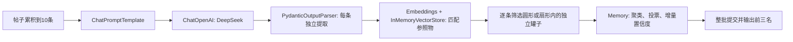

# LangChain 沙盘火灾定位 Demo

按 `note.txt` 的设计实现。重点是熟悉 LangChain 组件和跑通端到端流程。地图、Excel 和原设计文件保留原样。

从零学习可读 `LANGCHAIN_TUTORIAL.md`，并依次运行 `learning/` 的九个 demo；第一个命令是 `python -m learning.demo01_runnable`。默认离线教学，`--live` 显式切换真实 API。

本次已在 Anaconda `agent` 环境完成真实 API 回放：100 条输入、10 个批次、10 次 DeepSeek 调用、24 次编码请求（含静态地点初始化）、90 条参与聚类、10 条空候选忽略。最终前三为成品1号储罐、成品3号储罐、成品区缓冲罐，设定的唯一着火罐排名第一。15 项测试通过，`pip check` 无依赖冲突。详细结果见 `runtime/live/report.json`，这是模拟数据验证。

## 运行

使用已有的 Anaconda `agent` 环境（Python 3.12）。本地 `.env` 已配置提供的 API key，并加入 `.gitignore`，不要提交该文件。

```powershell
conda activate agent
python -m pip install -r requirements.txt
python -m fire_locator generate --count 100
python -m fire_locator replay
```

如果当前终端无法激活 conda，直接用环境内的解释器：

```powershell
& D:\Anaconda\envs\agent\python.exe -X utf8 -m fire_locator replay
```

`generate` 先指定唯一着火罐（默认成品1号储罐），再依据地图几何关系生成观察帖子。100 条帖子在 34 分钟内出现，所有发帖点为 Excel 中的非罐位置。输入在 `data/demo_posts.jsonl`；真实着火标签单独存入 `data/demo_posts.meta.json`，不进入大模型提示词或定位过程。

指定另一只罐子或随机种子：

```powershell
python -m fire_locator generate --target POI-HA-SE-03 --seed 123 --output data/another.jsonl
python -m fire_locator replay --input data/another.jsonl --output-dir runtime/another
```

接口失败时，整批不更新簇，已接收的帖子保留在 `memory.json` 的待处理队列。修复配置后继续：

```powershell
python -m fire_locator replay --resume
```

明确使用离线测试替身（字符哈希向量、规则提取），不调用 API：

```powershell
python -m fire_locator replay --offline
python -m pytest -q
python -m fire_locator.doctor
```

真实运行出错不会自动改成离线模式。`doctor` 只检查两个真实接口的状态、模型和向量维度，不打印 key 或向量内容。

## 一批 10 条的含义

一次 DeepSeek 调用接收 10 条帖子，返回 10 个独立提取对象，每条各自有一个参照物和一个方向。程序检查全部 ID 一一对应，禁止漏条、重复和额外 ID，然后按时间顺序逐条定位并更新 Memory，整批完成后发布一次预测。不是给整批共用一个参照物和方向，也不是对 10 条分别发起 10 次大模型调用。

不足 10 条的实时输入先等待下一条；`flush=True` 可以显式处理尾批。CLI 回放会自动 flush 文件末尾。

## 流程和 LangChain 组件



| 组件 | 实现位置和用途 |
| --- | --- |
| ChatModel | `providers.py` 的 `ChatOpenAI`，接入 DeepSeek 的 OpenAI 兼容接口 |
| PromptTemplate | `ChatPromptTemplate` 定义批量独立提取规则 |
| OutputParser | `PydanticOutputParser` 与 Pydantic 枚举/对象校验 |
| Embeddings | `SiliconFlowEmbeddings` 继承 LangChain `Embeddings`，调用指定的 Qwen VL 模型 |
| VectorStore | LangChain `InMemoryVectorStore` 保存登记地点名称向量并检索 |
| cosine_similarity | `math_utils.py` 的 NumPy 余弦计算，用于核对检索分数；向量库自身也按余弦检索 |
| Memory | `LocalizationMemory` 保存领域状态，原子写入本地 JSON 并支持恢复 |
| LCEL / Runnable | `prompt \| model \| parser` 与 `batch_runnable.invoke()`，可供另一个 LangChain Agent 调用 |

这里的 Memory 存储簇、投票、向量统计量、队列和去重记录，使用专门的领域结构，不把这些状态塞进聊天历史。无需部署外部向量数据库；静态地点数据很小，每次启动用缓存向量重建内存向量库。

## 定位和聚类规则

1. Excel 为名称/坐标的来源；读取 28 个 POI、区域、道路、路口。JSON 用来核对 28 个 POI 的坐标并载入 1082 条预计算空间关系及邻居数据。JSON 里的 3.2m `near` 阈值不覆盖 note 的 10m 搜索规则。
2. 只允许一个参照物、一个方位。没有参照物，直接采用发帖位置，跳过语义检索。提取到参照物时，编码原文名称并与登记名称做余弦匹配，最高值严格 **大于 0.7** 才接受，否则退回发帖位置。别名可以由模型原样提取，再进行语义匹配。
3. 八方向使用半径 10m、总张角 45° 的扇形；附近使用半径 10m 的圆。边界包含在内。区域参照点采用 Excel 边界框中心，道路采用线段中点，路口采用登记坐标。
4. 仅 `type == tank` 的 **14 只独立罐子** 可作为候选/答案，`tank_group` 不可。没有罐子落入范围的帖子忽略并记录原因。
5. 新候选与活跃簇的候选集合相交则归入；都不相交则建新簇。若一条帖子同时连接多个簇，则合并这些簇再追加一次，避免重复投票。簇维护候选集合、各罐投票数和当前领先罐。
6. 每条有效帖子给自己的每个候选罐投一票。紧急度保留供后续实验，当前不额外加权，因为高紧急度不等于高信息量或准确度。
7. 超过 60 分钟无新帖子加入的簇变冷，保留历史状态，不再接收帖子，也不参与当前排名。恰好 60 分钟仍活跃。后续同位置新帖子可创建新簇。
8. 每只罐子的分数为活跃簇中 `该罐票数 × max(簇置信度, 0)` 的总和，按分数、票数、POI ID 排序，输出最多 3 个不同的罐子。结果含名称、ID、米制沙盘坐标、票数、文本一致性和相对分数。少于 3 个候选时只输出实际数量。

`confidence` 衡量帖子文本的一致性，单帖子约定为 1 并保留簇样本数。`relative_score` 是在全部候选罐中的归一化分数，不是经校准的着火概率。低相关帖也可能贡献投票，本轮保持 note 的简化流程，未额外引入火情分类或准确率优化。

## 增量置信度：无需近似即可减少计算

设每条帖子向量归一化后为 `u_i`，簇内有 `n` 条帖子，保存 `S = sum(u_i)`。

两两余弦的平均值可以严格写成：

```text
C = (dot(S, S) - n) / (n * (n - 1))    # n >= 2
```

追加一条帖子时只更新 `S += u_new` 和 `n += 1`，耗时 O(d)，内存 O(d)，不需要扫描历史帖子。合并簇时将两簇的 `S` 与 `n` 相加即可。测试用随机向量检查每次追加及合并，结果与全量两两余弦平均一致（浮点误差范围内）。

## 接收另一个 Agent 的帖子

本地单进程 HTTP 服务：

```powershell
python -m uvicorn fire_locator.api:app --host 127.0.0.1 --port 8000
```

打开 [接口文档](http://127.0.0.1:8000/docs)。`GET /pois` 返回可用地点及 `can_post`；`GET /health` 为轻量健康检查。

```python
from datetime import datetime
from zoneinfo import ZoneInfo
import requests

now = datetime.now(ZoneInfo("Asia/Shanghai")).replace(second=0, microsecond=0)
response = requests.post("http://127.0.0.1:8000/posts", json={
    "posts": [{
        "id": "agent-post-001",
        "timestamp": now.isoformat(),
        "text": "检修车间南边有浓烟，像是罐体那边冒出来的！",
        "location_poi_id": "POI-HA-NW-02",
        "urgency": "高"
    }],
    "flush": False
})
response.raise_for_status()
print(response.json())
```

帖子累计到 10 条后处理；也可以一次提交 10 条或更多，每批仍独立调用大模型。`POST /posts` 传 `{"posts": [], "flush": true}` 可处理剩余帖子或重试待处理批次。`GET /prediction` 返回当前有效的前三名，静默期间超过一小时的历史证据也会自动从查询结果中排除。

HTTP 接口要求帖子在最近 60 分钟内，历史模拟数据用 CLI `replay`。实时入口与回放使用不同的状态目录。仅运行一个 uvicorn worker，本地 JSON Memory 不支持多进程并发写入。

同一个 Python 环境可以直接接入：

```python
from pathlib import Path
from fire_locator.engine import FireLocalizer

localizer = FireLocalizer(state_path=Path("runtime/integration/memory.json"), resume=True)
result = localizer.ingest(posts)   # list[Post] 或 list[dict]
```

## 输入、状态和输出文件

时间戳须精确到分钟；无时区时按 Asia/Shanghai 解读。帖子按时间非递减到达，CLI 会先排序。相同 ID 与内容重复提交会被去重；相同 ID 但内容改变会报错。非法 POI、罐体发帖位置或时间逆序不会部分入队。

真实运行输出在 `runtime/live/`，离线输出在 `runtime/offline/`：

| 文件 | 内容 |
| --- | --- |
| `report.json` | 模式、处理数、API 调用数、最终预测和模拟标签评价 |
| `prediction.json` | 最终前三候选罐的 ID、名称和坐标 |
| `batch_results.json` | 每批的 10 条独立提取、回退理由、候选及预测历史 |
| `clusters.json` | 簇的票数、文本一致性和领先罐 |
| `memory.json` | 重启恢复用状态，含 pending 和去重信息 |
| `failure.json` | 失败类型和重试方式，仅失败时写入 |

`runtime/embedding_cache.json` 为按供应商、模型及文本哈希隔离的编码缓存，保存名称和帖子向量，不保存 key。修改地图、模型或几何规则后应使用新的状态目录，恢复时会检查这些配置是否一致。

实测硅基流动的 VL 编码接口一次传 10 段文本时，返回 index 为 `0..7,0,1`。适配器将编码请求拆成最多 8 段，严格校验并按 index 对齐向量，避免错误配对。这不影响 DeepSeek 每次对 10 条帖子独立提取的批处理方式。

回放结果的 `current_time` 为模拟时间；实时查询使用上海当前时间。坐标是 30m × 25m 沙盘的本地米制坐标，原点在西南，x 向东、y 向北。

## 参考接口

本次十罐真实实验结果在 `runtime/benchmarks/20261008_10tanks_seed20261008/`，逐组结果见 `report.md`，错因诊断见 `analysis.md`。随机抽样种子为 20261008，每罐 100 条、十批，第一名命中 9/10，前三命中 10/10。

用新目录复现实验：

```powershell
python -m experiments.real_benchmark --selection-seed 20261008 --output-dir runtime/benchmarks/rerun_10tanks
python -m experiments.analyze_real_benchmark --output-dir runtime/benchmarks/rerun_10tanks
```

实验脚本只运行真实 API；模板帖子生成仍在本地完成。`--resume` 用于继续未完成的同一次实验，已完成的个案会跳过。

- [LangChain InMemoryVectorStore](https://docs.langchain.com/oss/python/integrations/vectorstores/in_memory)
- [SiliconFlow Embeddings](https://siliconflow.readme.io/reference/createembedding)
- [DeepSeek 官方调用说明](https://api-docs.deepseek.com/)
